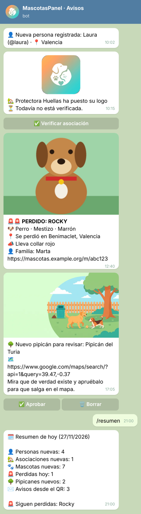

# Bot de Telegram para MascotasPanel

*[English below](#telegram-bot-for-mascotaspanel)*

Tu propio bot de Telegram te avisa de todo lo que pasa en tu MascotasPanel, con fotos, y te deja aprobar
cosas desde el móvil sin entrar en la web. No hace falta abrir puertos ni que la web esté en Internet: tu
servidor pregunta a Telegram cada poco si has pulsado algo.

<p align="center"></p>

## Qué te avisa

| Aviso | Con foto | Botones |
|---|---|---|
| 👤 Persona nueva registrada | | |
| 🏡 Asociación nueva registrada | su logo, cuando lo sube | ✅ Verificar asociación |
| 🐾 Mascota nueva | su foto | |
| 🚨🚨 **PERDIDO**: una mascota se ha perdido (zona, señas, aviso) | su foto | |
| 🏠🎉 Una mascota perdida ya está en casa | su foto | |
| ✉️ Alguien ha mandado un aviso desde el QR (destacado si está perdida) | su foto, si está perdida | |
| 💛 Un animal se pone en adopción / alguien quiere adoptarlo | su foto | |
| 🌳 Pipicán nuevo o cambiado, para revisar | su foto | ✅ Aprobar · 🗑️ Borrar |
| 🗓️ Resumen del día, cada noche a las 21:00 (se puede quitar) | | |

Por privacidad, el bot **nunca** manda el microchip, el teléfono de nadie ni lo que alguien le escribe a una
familia desde el QR.

## Comandos

Escríbeselos al bot:

- `/estado`: cuántas personas, asociaciones, mascotas, perdidas, adopciones y pipicanes hay.
- `/resumen`: el resumen de hoy (registros del día y totales).
- `/perdidas`: las mascotas perdidas ahora, con su foto.
- `/pendientes`: lo que tienes que revisar (asociaciones y pipicanes), con sus botones.
- `/ayuda`: la lista de comandos.

## Cómo crearlo (3 pasos, 2 minutos)

1. En Telegram, abre **@BotFather**, escribe `/newbot`, ponle un nombre (por ejemplo «Mi MascotasPanel») y un
   usuario que acabe en `bot` (por ejemplo `mi_mascotas_bot`). Te dará un **token** como `123456789:ABC…`.
2. En tu MascotasPanel, entra en **Administración → Avisos por Telegram**, pega el token y pulsa
   **«Guardar el token»**.
3. Pulsa **«Conectar con mi Telegram»**: se abre tu bot. Pulsa **Iniciar**. El bot te contesta «✅ ¡Conectado!» y
   ya está.

Si quieres, pulsa **«Mandar un mensaje de prueba»**. Para quitar los avisos, **«Quitar los avisos»**.

**Cosas que conviene saber:**

- El token es como una contraseña: se guarda solo en tu servidor y no se vuelve a enseñar entero.
- Usa un bot **solo para MascotasPanel**. Si el mismo bot lo usa otro programa, los botones no funcionan bien.
- El bot es privado: si otra persona le escribe, le contesta que es privado y no hace nada.
- El enlace de «Conectar» vale 30 minutos. Si caduca, vuelve a pulsar el botón.

## Prompt para pedírselo a una IA

¿Prefieres que te guíe una IA (Claude, ChatGPT…)? Copia esto y pégalo en el chat:

```text
Quiero conectar un bot de Telegram a mi MascotasPanel (un registro de mascotas que tengo instalado en mi
servidor). No soy programador: explícamelo paso a paso, con frases cortas, y espera a que te diga «hecho»
antes de pasar al siguiente paso.

Lo que hay que hacer:
1. En Telegram, abrir @BotFather, escribir /newbot, elegir un nombre y un usuario que acabe en «bot», y copiar
   el token que da (es como 123456789:ABC...). Recuérdame que el token es como una contraseña y que no se lo
   enseñe a nadie (tampoco a ti).
2. En MascotasPanel: Administración → Avisos por Telegram → pegar el token → «Guardar el token».
3. Pulsar «Conectar con mi Telegram», que abre el bot, y pulsar «Iniciar». El bot contesta «¡Conectado!».
4. Probar con «Mandar un mensaje de prueba» y escribiendo /estado al bot.

Si algo falla, ayúdame con esto:
- «El token no parece válido»: que lo copie entero otra vez desde @BotFather (/mybots → mi bot → API Token).
- «Telegram dice que el token no vale»: el token se ha cambiado; hay que copiar el nuevo.
- «No se puede conectar con Telegram desde el servidor»: el servidor no tiene Internet o algo bloquea
  api.telegram.org.
- Los botones no hacen nada: el mismo bot lo está usando otro programa; hay que crear un bot solo para esto.
- El enlace de «Conectar» ha caducado: volver a pulsar el botón (vale 30 minutos).

Al final, explícame qué avisos me van a llegar y los comandos /estado, /resumen, /perdidas, /pendientes y /ayuda.
```

---

# Telegram bot for MascotasPanel

Your own Telegram bot tells you everything that happens in your MascotasPanel, with photos, and lets you
approve things from your phone. No open ports needed and the website doesn't need to be on the Internet: your
server asks Telegram every few seconds whether you have tapped anything.

**It notifies you about:** new people and associations (with the association's logo and a ✅ *Verify* button),
new pets (with photo), **🚨 LOST** pets (photo, area, markings), pets back home, notices sent from the QR,
adoptions, new or edited dog parks to review (photo, ✅ *Approve* and 🗑️ *Delete* buttons) and a daily summary
at 9 pm (can be turned off). It never sends microchips, phone numbers or what someone writes to a family.

**Commands:** `/estado` (totals), `/resumen` (today's summary), `/perdidas` (lost pets now), `/pendientes`
(things to review, with buttons), `/ayuda` (help). The bot's messages are in Spanish.

**Set it up in 3 steps:**

1. In Telegram, open **@BotFather**, type `/newbot`, choose a name and a username ending in `bot`. Copy the
   **token** (like `123456789:ABC…`).
2. In MascotasPanel, go to **Administration → Telegram notifications**, paste the token and tap **Save the token**.
3. Tap **Connect my Telegram**, then **Start** in the bot. It replies "✅ ¡Conectado!". Done.

Use a bot only for MascotasPanel, keep the token private, and if the connect link expires (30 minutes), tap
the button again.

**Prompt for an AI assistant:** copy the Spanish prompt above, or this one:

```text
I want to connect a Telegram bot to my MascotasPanel (a pet registry installed on my own server). I'm not a
programmer: guide me step by step, in short sentences, and wait until I say "done" before the next step.
1. In Telegram, open @BotFather, type /newbot, choose a name and a username ending in "bot", and copy the
   token (like 123456789:ABC...). Remind me the token is like a password and not to show it to anyone (not even you).
2. In MascotasPanel: Administration → Telegram notifications → paste the token → "Save the token".
3. Tap "Connect my Telegram", which opens the bot, then tap "Start". The bot replies "¡Conectado!".
4. Test with "Send a test message" and by sending /estado to the bot.
If something fails: re-copy the token from @BotFather (/mybots → my bot → API Token); check the server can reach
api.telegram.org; use a bot that no other program uses; tap "Connect" again if the link expired (30 minutes).
At the end, explain which notices I'll get and the commands /estado, /resumen, /perdidas, /pendientes and /ayuda.
```
